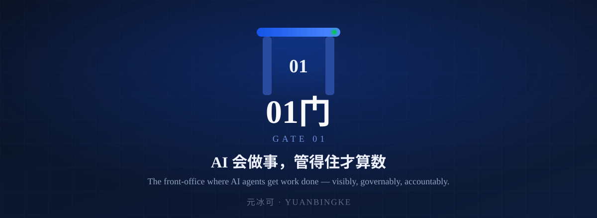
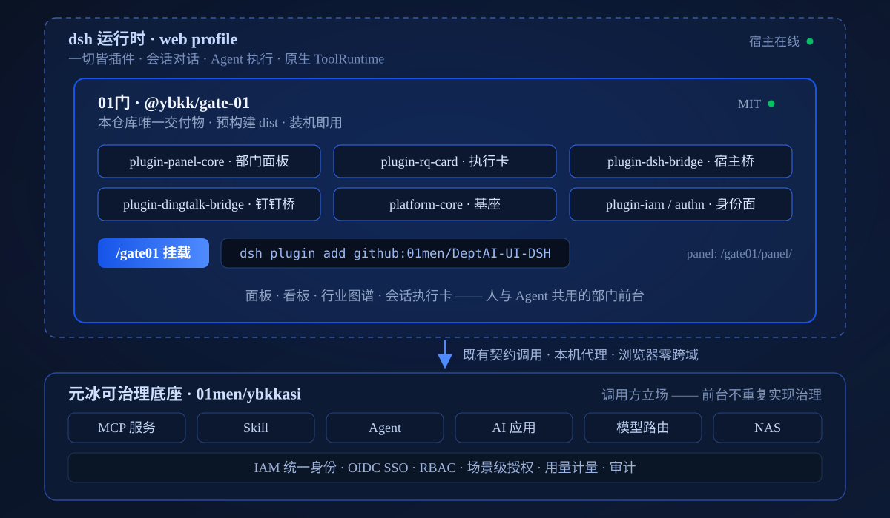

<div align="center">
  

  [简体中文](README.md) · **English** · [Agent view (llms.txt)](llms.txt)

  [](https://www.npmjs.com/package/@ybkk/gate-01)
  [](LICENSE)
  [](docs/plan-gate01.md)
  [](tests/selftest.mjs)

  ```bash
  dsh plugin add github:01men/DeptAI-UI-DSH
  ```
</div>

## What is this

**Gate 01（01门）** is the **collaboration front-office for AI agents and humans** — it brings
day-to-day department work (boards, tickets, approvals, industry calculations) into the dsh
conversation and panel surface: **agents do the work in chat, humans see and govern it in the panel**.

- **One-command install**: ships as a cordis plugin; once installed it mounts at `/gate01` —
  open `/gate01/panel/` and the built-in demo board is already there;
- **Front-office stance**: it *calls* the Yuanbingke governance base
  [01men/ybkkasi](https://github.com/01men/ybkkasi) over existing contracts (six managed asset types
  plus IAM / OIDC SSO / RBAC / scene-level authorization) — the front-office never re-implements governance;
- **Clean exit anytime**: `dsh plugin remove` uninstalls cleanly; reinstall restores everything.

> Owned by **Hangzhou Yuanbingke Technology Co., Ltd.** (brand: Yuanbingke / 元冰可).
> Positioning record: [docs/positioning-rq-dsh-panel-project-20261019.md](docs/positioning-rq-dsh-panel-project-20261019.md) (Chinese).

## Capabilities

All shipped — nothing on this list is a plan.

- 🏢 **Department space workbench** — boards for R&D / manufacturing / sales / strategy / finance:
  KPI cards, ticket flow, approval trails, live event streaming (SSE)
- 🏭 **14 industry scenegraph packs + theme engine** — construction machinery, robotics, home appliances,
  NEV, petrochemical, lithium battery, PCB, medical equipment, steel and more; industries plug in,
  inactive ones stay browsable in read-only preview
- 🧮 **Manufacturing AI toolkit** — 13 calculation kernels + 3 AI tools + 100 curated topics
  (OEE, Cpk, takt/capacity and other front-line tools) in the manufacturing space
- 💬 **Execution cards in chat** — four-state task cards bridging conversation and board,
  so agent progress is visible the moment it happens
- 🔐 **DingTalk device-flow sign-in** — the panel initiates authorization; unauthenticated users get an
  activation code automatically — zero onboarding friction for the front line
- 📡 **Honest degradation** — when the governance base is unreachable or the remote host lacks a
  capability, a banner says so plainly; nothing fails silently

## Quick start

```bash
dsh plugin add github:01men/DeptAI-UI-DSH
```

1. Open **`http://127.0.0.1:<dsh port>/gate01/panel/`** — the built-in demo board works with zero configuration;
2. Once connected to the governance base, all live data flows through a localhost proxy
   (zero cross-origin in the browser); sign-in happens on the base side;
3. npm package **`@ybkk/gate-01`** and local `link:` / `file:` channels are also available
   (four install channels, [details in Chinese](docs/plan-gate01.md)).

## Architecture



- **Lives inside dsh**: panel and cards start with the host; `/gate01` is a single port, single entry — no separate deployment surface;
- **Six bundled packages**: install artifacts are prebuilt dist — no TypeScript loading, no lifecycle scripts, works right after install;
- **Front-office × base**: the data plane reaches the base through the host bridge's localhost proxy (zero browser CORS); identity, permissions, metering and audit all belong to the base.

## Engineering quality

- 🧪 **1300+ end-to-end self-tests, all green** (1367/1367 measured on 2026-10-29; full regression plus
  manifest linting before every delivery)
- 📦 **Fresh-install invariant** — every delivery is verified on a *freshly installed* dsh via the plugin
  flow (installation simulation is part of the self-test)
- 🚫 **Nothing executes at install time** — prebuilt dist artifacts, no lifecycle scripts, no runtime compilation
- 🧯 **Fail-closed + honest degradation** — security defaults to deny, capability gaps are surfaced, every action is audited
- 🤖 **Agent-friendly** — [llms.txt](llms.txt) provides a machine-readable view; the panel REST API
  (`/api/panel/*`) and SSE event stream are open to agents on the same contract

## Documentation

| Document | Contents |
|---|---|
| [Product definition](docs/plan-gate01.md) | Product shape, install invariant, install channels, boundaries (Chinese) |
| [Agent view](llms.txt) | Machine-readable fact card for LLMs / agents (Chinese + English) |
| [Enterprise deployment](docs/deploy-enterprise.md) | Deployment runbook and base integration (Chinese) |
| [Product one-pager](产品.html) | Decision-maker one-pager (online: <http://mdzx.fun:8801/product.html>) |
| [Governance base](https://github.com/01men/ybkkasi) | The provider of assets & identity — a separate project |

## Feedback & licensing

- File issues on GitHub — the repo runs a daily automated patrol; feedback gets triaged within 48 hours;
- Commercial: priced by **team + domain assets**; manufacturing customers can opt for
  project-based private delivery. Contact details are on the [product one-pager](产品.html).

## License

[MIT](LICENSE) © Hangzhou Yuanbingke Technology Co., Ltd.（杭州元冰可科技有限公司）
