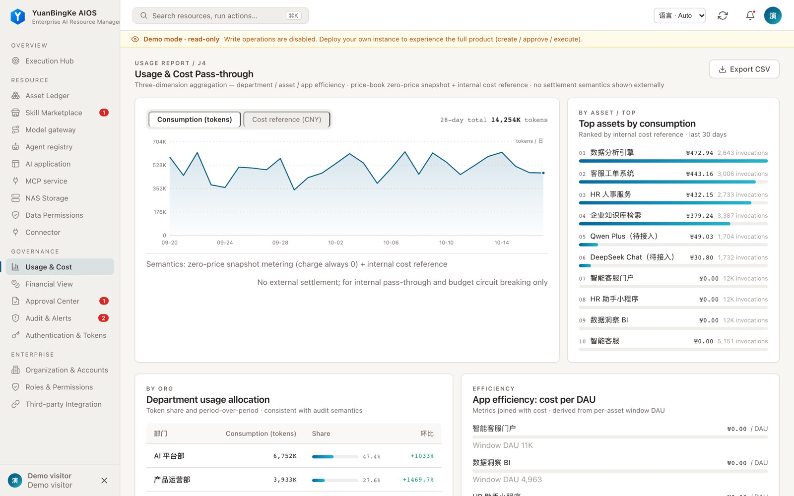
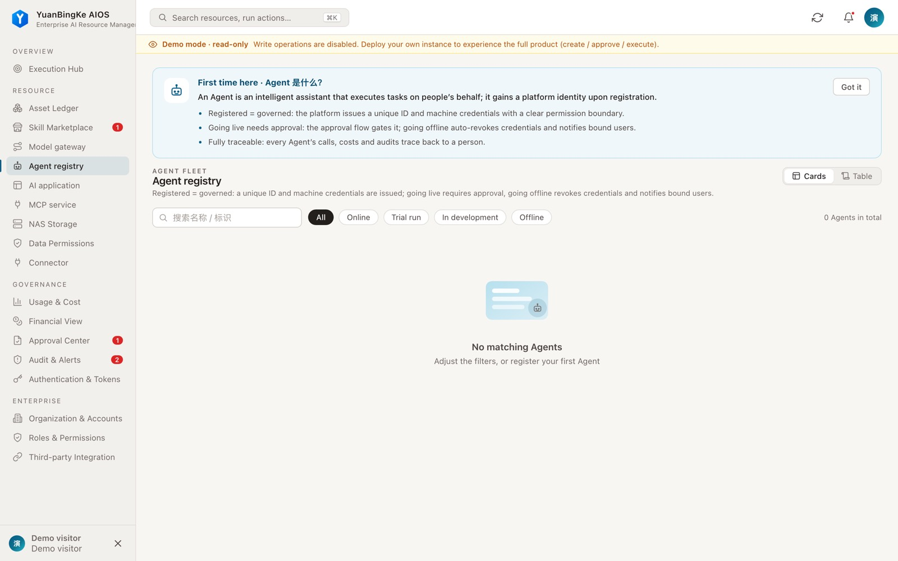
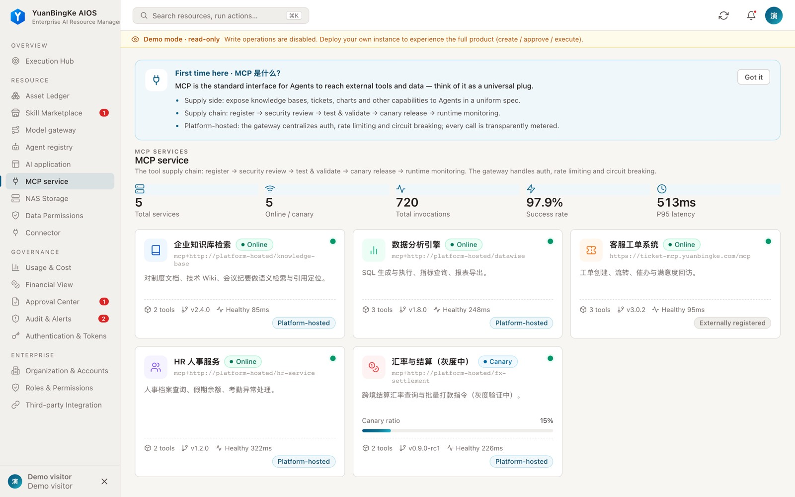
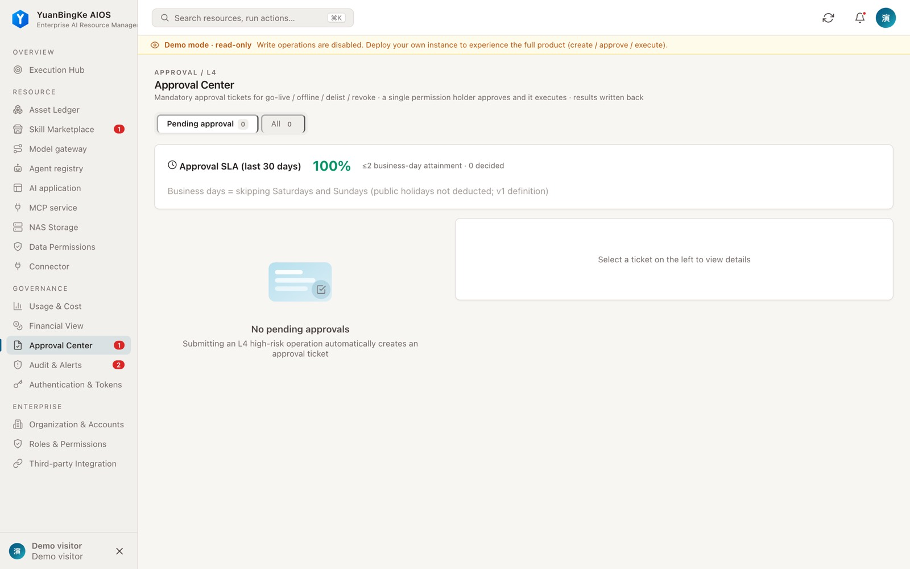

<p align="center">
  
</p>

<h1 align="center">元冰可 AIOS</h1>

<p align="center"><strong>元冰可 AIOS —— 数字员工的公司：任务、审批、预算、审计，一个控制台管住。</strong></p>
<p align="center">YuanBingKe AIOS (YBK ASI) — the company for your digital employees: tasks, approvals, budgets, audit in one control plane.</p>
<p align="center">面向企业的 AI 运行与治理平台 · 支持自主部署 · 基于 dsh / cordis 插件体系</p>

<p align="center">
  <a href="https://github.com/01men/ybkkasi/actions/workflows/quality-gate.yml"></a>
  <a href="LICENSE"></a>
  <a href="https://nodejs.org/"></a>
  <a href="https://star-history.com/#01men/ybkkasi&Date"></a>
</p>

<p align="center">
  <strong>简体中文</strong> · <a href="docs/i18n/en/README.md">English</a> · <a href="README.agent.md">Agent</a>
</p>

<p align="center">
  <a href="https://demo.ybkkasi.com/"><strong>在线体验</strong></a> ·
  <a href="#三步上手">三步上手</a> ·
  <a href="#快速开始">快速开始</a> ·
  <a href="#接入-dsh">接入 dsh</a> ·
  <a href="#面向-agent-和开发者">Agent 接入</a> ·
  <a href="docs/deploy-enterprise.md">部署指南</a> ·
  <a href="#联系我们">联系我们</a>
</p>

[](https://demo.ybkkasi.com/)

> **一句话**：模型、数据、知识库、Agent 都是新的生产资料，但旧的生产关系（谁拥有、谁调配、谁分账）不换，堆再多工具也释放不出生产力——为什么，以及元冰可怎么解，见[设计理念](#设计理念)。

## 三步上手

| 步骤 | 你要做的事 | 平台里的对应物 |
| --- | --- | --- |
| **1 · Goal 定目标** | 把业务目标拆成项目与任务，挂到组织名下 | 执行中枢的目标血缘：目标 → 项目 → 任务；派单受控、交付有验收记录 |
| **2 · Hire 招数字员工** | 数字员工登记主组织与真人主管，绑定技术 Agent | 数字员工名册与状态（在职 / 离岗）、权限矩阵、生命周期 |
| **3 · Run 跑起来** | 唤醒任务、控审批与预算，事后算账留痕 | 任务唤醒与执行记录、审批中心、模型渠道预算、用量与成本、审计日志 |

想先看效果，直接开[在线演示 demo.ybkkasi.com](https://demo.ybkkasi.com/)。

## 快速开始

在线体验无需安装：[demo.ybkkasi.com](https://demo.ybkkasi.com/)。

本地使用 Docker Compose 启动一个只读演示实例：

```bash
git clone https://github.com/01men/ybkkasi.git
cd ybkkasi
docker compose up -d
```

打开 [http://localhost:7300](http://localhost:7300)。演示模式会让访客访问实例的只读数据，请仅在隔离的演示环境使用，不要接入真实业务数据。

作为 dsh 插件接入（`web` profile）：

```bash
dsh plugin --profile web add github:01men/ybkkasi
```

如需从源码启动独立实例，需要 Node.js ≥ 22.6：

```bash
npm ci
npm start
```

独立实例默认不注入演示数据。首次启动凭据、持久化、备份和企业部署配置见[部署指南](docs/deploy-enterprise.md)。

## 界面

以下截图来自本仓库的演示实例，数据为演示数据：

| 数字员工 | MCP 服务 | 审批与审计 |
| --- | --- | --- |
| [](https://demo.ybkkasi.com/) | [](https://demo.ybkkasi.com/) | [](https://demo.ybkkasi.com/) |

## 设计理念

### 堆工具为什么不管用

企业落地 AI 的常见路径是不断采购新工具：一个模型、一个 Agent 框架、一批 MCP 服务。工具越堆越多，组织产出却没有同步变化——问题不在工具不够好，而在**新生产力遇上了旧生产关系**。

生产关系回答三个问题：**人如何占有和使用生产资料**，**人如何分工协作**，**劳动成果如何在组织与个体之间分配**。模型、数据、知识库、智能体是新的生产资料，但当这些资产没有确权、分工仍围绕固定岗位、信息权仍集中在管理层、个体创造的价值既测不到也分不到时，工具换了一茬又一茬，生产力始终释放不出来。

### 元冰可 AIOS 是什么：新生产关系的运行底座

元冰可不打算成为采购清单上的第 N 个 AI 工具。它把企业围绕 AI 重组生产关系所必需的制度基础设施做成了可运行的软件：连接企业的目标、数字员工与 AI 能力，让任务执行、能力调用和交付验收有迹可循。数字员工是协作主体；MCP 服务、Skill、模型渠道、知识库和应用是登记在组织名下的资产。

AI 原生组织需要在五个方面重塑生产关系，平台在每一项下面都有一层底座：

| 重塑点 | 生产关系怎么变 | 元冰可的底座 |
| --- | --- | --- |
| **人与生产资料** | 模型、数据、知识库、智能体需要明确谁拥有、谁使用、谁配置、谁收益；个体不再只是被配发工具的使用者 | 资产以组织登记确权：MCP 服务、Skill、模型渠道、应用、数字员工均有归属组织、权限矩阵与生命周期（发布、审批、下线），使用先过授权 |
| **分工** | 从固定岗位职责，转向按业务结果拆工作流、在人机之间动态派单——谁更快、更便宜、更丝滑，活就派给谁 | 围绕目标、项目、任务组织数字员工协作，任务受控派发、能力受控调用、交付有验收记录，派单过程可追溯 |
| **人与权力** | 信息权不再靠管理层垄断：谁对结果负责、谁能调动智能体，谁就有权 | 权力下沉但不失控：「调动智能体」是可授权的正式权力——工具按调用方权限过滤、on-behalf-of 令牌链、L4 高风险操作强制审批、全程审计 |
| **协作** | 从标准化、稳固的流程，转向分工模糊化、快速迭代 | 平台自身即插件树：各业务域独立启停，协作只经事件总线与扩展点，边界靠接口契约而不是固定岗位 |
| **价值分配** | 个体撬动的价值急剧放大、议价能力上升：回报和溢价给不够，人就会带着能力出去单干 | 每次能力调用幂等计量，透明用量与内部成本参考，未定价显式标注而非记零——先让价值可测、可归账，分配才有依据 |

结论与平台的立场一致：**不解决人与生产资料、人与价值分配的对等问题，这场生产力变革就驱动不起来。** 元冰可不做货币结算，也不替企业做分配决策；它把确权、派单、授权、计量做成每天都在运行的制度，让「用 AI 的人」和「创造的价值」在同一本账上对得上。

## 它是怎么搭起来的

实例本身是一棵 cordis 插件树，与 dsh 使用同一个插件框架。每个业务域是一个独立插件包，自行声明依赖、权限点和事件，可以单独启停；跨插件协作只经由事件总线和扩展点，插件之间不直接读写彼此的数据。仓库包含 25 个插件清单与 9 份领域运维 Skill。

这意味着治理能力不是加在平台外层的补丁，而是每个域自身的一部分：组织、身份、权限、计量、审计各自有归属插件，也各自对调用方负责。

## 接入 dsh

项目提供 dsh `web` profile 的插件包；仓库声明的兼容范围为 `>=0.1.0-rc.7 <0.3.0`，逐版本登记见 `package.json` 的 `dsh.compatibility.dshReleases`（已实测 `0.1.0-rc.7`、`0.2.1-rc.5`）。dsh 挂载仍属实验性接入，请先在隔离环境验证所用版本。安装命令见[快速开始](#快速开始)。

挂载配置将控制台和 API 放在 dsh Web 服务的 `/rq` 前缀下。远程 dsh 也可通过一次性接入码连接已有平台，凭证与授权范围由管理员管理。接入和部署细节见[部署指南](docs/deploy-enterprise.md)。

## 面向 Agent 和开发者

| 入口 | 用途 |
| --- | --- |
| [Agent 视图](README.agent.md) | 给自动化调用方的接入事实与安全边界 |
| [llms.txt](llms.txt) | 项目概要、Agent 操作边界与文档索引 |
| [运维 Skill 索引](skills/dsh-ops-admin/SKILL.md) | 按领域查找运维手册；可直接读取或安装到 dsh 的 Skill 目录 |
| `POST /mcp` | 平台运维工具的 MCP 接口；工具列表按调用方权限过滤 |
| `GET /api/openapi.json` | 当前实例的 REST 接口描述，需要授权 |
| [命令行工具](cli/dshctl.mjs) | 平台运维 CLI，支持 `--output json` |

以上路径以独立实例为例；dsh 挂载形态使用 `/rq` 前缀。访问受保护接口时请使用获得授权的凭据。CLI 的 `--dry-run` 仅对明确支持预演的操作有效；其他写入会被拒绝。

接口与工具数量随版本和调用方权限变化，不在本文档中固定——以目标实例的 `/api/openapi.json` 与 `/mcp` 返回为准。

## 运行边界

- **数据与可用性**：当前存储形态面向单进程运行，不应让多个进程同时使用同一数据目录；部署前请规划备份和恢复。
- **权限与凭据**：按需授予最小权限，妥善保管令牌、接入码和密钥；审计和审批以实际配置及操作权限为准。
- **模型与工具**：真实调用需要配置相应服务和凭据；演示数据及演示执行结果不代表生产调用。

## 文档与社区

[架构说明](docs/ARCHITECTURE.md) · [企业部署](docs/deploy-enterprise.md) · [更新记录](CHANGELOG.md) · [贡献指南](CONTRIBUTING.md) · [i18n 治理](docs/i18n/README.md) · [English](docs/i18n/en/README.md) · [日本語](docs/i18n/ja/README.md) · [Agent](README.agent.md)

## 技术笔记

做这套东西踩过的坑，写成了长文，不在别处，就在本仓 Discussions 和官网：

| 主题 | 一句话 |
| --- | --- |
| [模型账单月底出来，没人说得清哪个部门花的](https://ybkkasi.com/blog/cost-attribution/) | 归口字段必须在消耗发生那一刻强制写上，并且允许它让调用失败。[Discussion #22](https://github.com/01men/ybkkasi/discussions/22) |
| [Agent 需要的权限是动态的，传统权限模型在这里崩掉](https://ybkkasi.com/blog/agent-permissions/) | 一个 40 毫秒的调用配一个 7 天的 token，中间所有设计都是空的。[Discussion #23](https://github.com/01men/ybkkasi/discussions/23) |

## 联系我们

商业合作、企业部署支持、使用问题或 bug 反馈，任一渠道均可（bug 建议优先提 [GitHub issue](https://github.com/01men/ybkkasi/issues)）：

| 渠道 | 入口 |
| --- | --- |
| 邮箱 | [ybkk01@126.com](mailto:ybkk01@126.com) |
| 企业微信群 | [扫码或点击入群](https://work.weixin.qq.com/ca/cawcdecedba18d0ddb) |
| Telegram 交流群 | [t.me/+YvW7087WEq9kMTg9](https://t.me/+YvW7087WEq9kMTg9) |
| GitHub | [01men/ybkkasi](https://github.com/01men/ybkkasi) · [Issues](https://github.com/01men/ybkkasi/issues) |

| 元冰可公众号（扫码关注） | Telegram 交流群（扫码加入） |
| --- | --- |
|  |  |

> 演示站 [demo.ybkkasi.com](https://demo.ybkkasi.com/) 的介绍页（/launch）底部同样挂有以上联系方式（`<contact-channels>` 组件，见 `packages/plugin-console/public/contact-channels/README.md`），可在任意页面复用。

本项目采用 [MIT License](LICENSE)。
