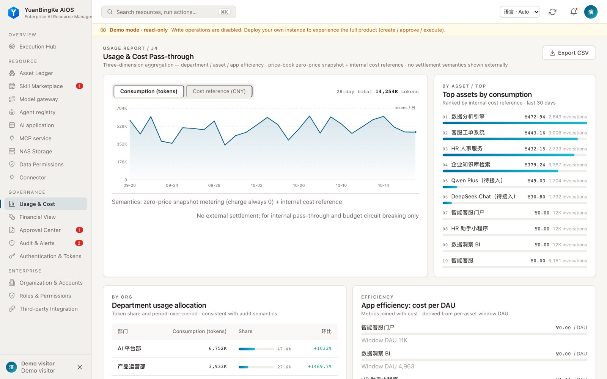
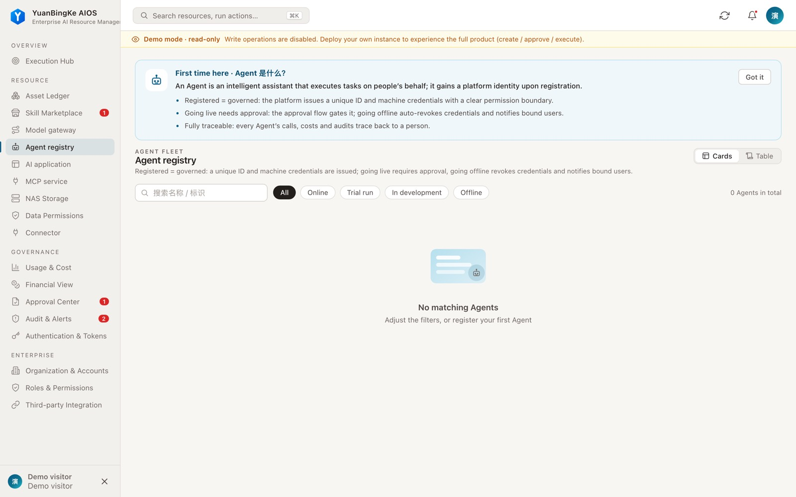
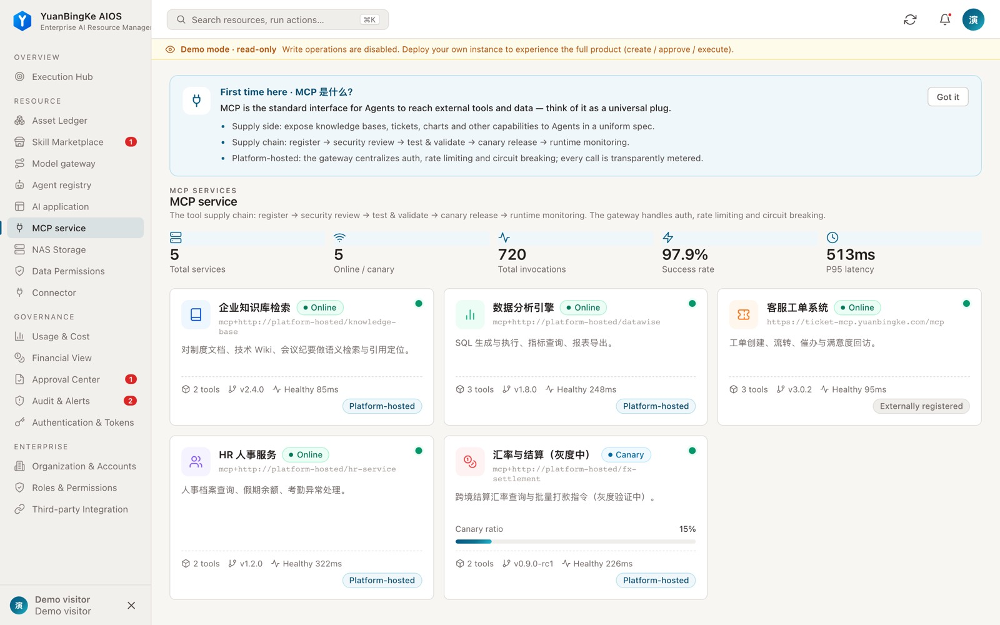
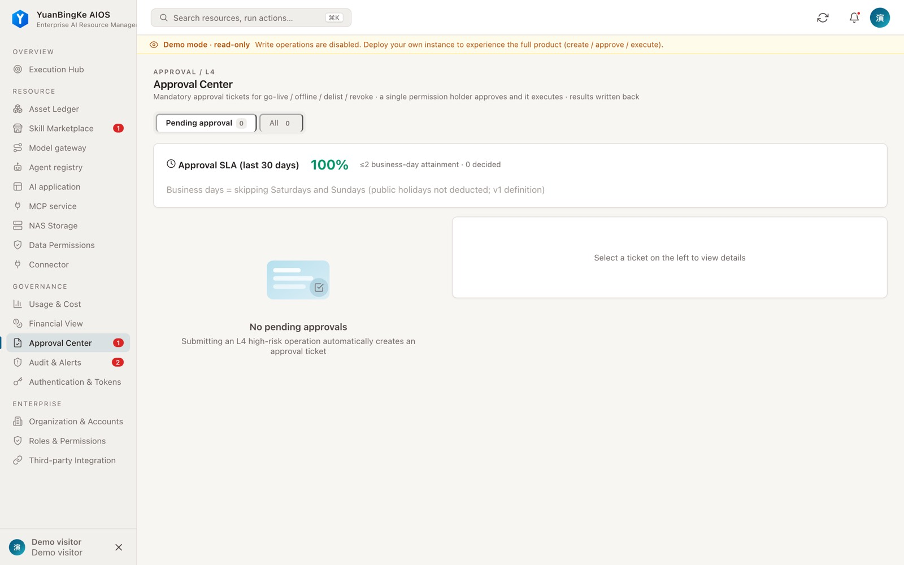

<p align="center">
  
</p>

<h1 align="center">YuanBingKe AIOS</h1>

<p align="center"><strong>YuanBingKe AIOS (YBK ASI) — the company for your digital employees: tasks, approvals, budgets, audit in one control plane.</strong></p>
<p align="center">元冰可 AIOS —— 数字员工的公司：任务、审批、预算、审计，一个控制台管住。</p>
<p align="center">An enterprise AI runtime and governance platform · Self-hosted · Built on the dsh / cordis plugin system</p>

<p align="center">
  <a href="https://github.com/01men/ybkkasi/actions/workflows/quality-gate.yml"></a>
  <a href="../../../LICENSE"></a>
  <a href="https://nodejs.org/"></a>
</p>

<p align="center">
  <a href="../../../README.md">简体中文</a> · <strong>English</strong> · <a href="README.agent.md">Agent</a> · <a href="../../../README.agent.md">Agent (中文)</a>
</p>

> **English edition** — machine-assisted translation, reviewed by the i18n PM. **The Chinese original governs.**
> Source: [`README.md`](../../../README.md), [`llms.txt`](../../../llms.txt) · Source updated: 2026-11-02 (first-screen restructure) · Glossary: [GLOSSARY.md](../GLOSSARY.md) · Governance: [README.md](../README.md)

<p align="center">
  <a href="https://demo.ybkkasi.com/"><strong>Live demo</strong></a> ·
  <a href="#three-steps-to-get-running">Three steps</a> ·
  <a href="#quick-start">Quick start</a> ·
  <a href="#mounting-into-dsh">Mount into dsh</a> ·
  <a href="#for-agents-and-developers">Agent access</a> ·
  <a href="deploy-enterprise.md">Deployment guide</a>
</p>

[](https://demo.ybkkasi.com/)

> **In one line**: models, data, knowledge bases, and agents are the new means of production — but if the old production relations (who owns, who allocates, who gets paid) stay as they are, no number of new tools frees up productivity. Why, and how YuanBingKe answers it: [Design principles](#design-principles).

## Three steps to get running

| Step | What you do | What it maps to in the platform |
| --- | --- | --- |
| **1 · Goal** | Break a business goal into projects and tasks, and attach them to an organization | The Execution Hub goal lineage: goal → project → issue; dispatch is controlled and delivery has an acceptance record |
| **2 · Hire** | Register a digital employee with an owning org and a human supervisor, and bind it to a technical Agent | The digital-employee roster and its states (active / offboarded), the permission matrix, and the lifecycle |
| **3 · Run** | Wake tasks, govern approvals and budgets, then account and audit afterwards | Task wake-ups and execution records, the approval center, model-channel budgets, usage and cost, audit logs |

Want to see it first? Open the [live demo at demo.ybkkasi.com](https://demo.ybkkasi.com/).

## Quick start

Try it online with no install: [demo.ybkkasi.com](https://demo.ybkkasi.com/).

To run a read-only demo instance locally with Docker Compose:

```bash
git clone https://github.com/01men/ybkkasi.git
cd ybkkasi
docker compose up -d
```

Open [http://localhost:7300](http://localhost:7300). Demo mode exposes the instance's read-only data to visitors, so use it only in an isolated demo environment and never connect it to real business data.

To mount it as a dsh plugin (`web` profile):

```bash
dsh plugin --profile web add github:01men/ybkkasi
```

To start a standalone instance from source, you need Node.js ≥ 22.6:

```bash
npm ci
npm start
```

A standalone instance seeds no demo data. First-boot credentials, persistence, backup, and enterprise deployment settings are covered in the [deployment guide](deploy-enterprise.md).

## Interface

The screenshots below come from this repository's demo instance. All data shown is demo data.

| Digital employees | MCP services | Approvals and audit |
| --- | --- | --- |
| [](https://demo.ybkkasi.com/) | [](https://demo.ybkkasi.com/) | [](https://demo.ybkkasi.com/) |

## Design principles

### Why stacking tools does not work

The usual path to adopting AI is to keep buying new tools: a model, an agent framework, a batch of MCP services. Tools pile up, but organizational output does not change with them. The problem is not tool quality — it is **new productive forces running into old production relations**.

Production relations answer three questions: **how people hold and use the means of production**, **how work is divided and coordinated**, and **how the fruits of work are distributed between the organization and the individual**. Models, data, knowledge bases, and agents are the new means of production. When those assets carry no clear ownership, when the division of labor still follows fixed positions, when information power stays concentrated in management, and when the value an individual creates can be neither measured nor shared, productivity stays locked up no matter how many tools get swapped in.

### What YuanBingKe AIOS is: a runtime foundation for new production relations

YuanBingKe does not aim to be the Nth AI tool on a procurement list. It turns the institutional infrastructure an enterprise needs in order to reorganize production relations around AI into runnable software: it connects the enterprise's goals, digital employees, and AI capabilities so that task execution, capability invocation, and delivery acceptance all leave a traceable record. Digital employees are the collaborating subjects; MCP services, skills, model routes, knowledge bases, and applications are assets registered under the organization.

An AI-native organization needs to reshape production relations in five places. The platform has a foundation under each:

| Reshaping point | How production relations change | The YuanBingKe foundation |
| --- | --- | --- |
| **People and the means of production** | Models, data, knowledge bases, and agents need explicit answers to who owns, who uses, who configures, and who benefits; individuals are no longer just users of issued tools | Assets are registered to the organization: MCP services, skills, model routes, applications, and digital employees all carry an owning organization, a permission matrix, and a lifecycle (release, approval, decommission). Authorization comes before use. |
| **Division of labor** | From fixed job positions to workflows decomposed by business outcome, with dynamic dispatch between humans and agents — whoever is faster, cheaper, and smoother gets the work | Work is organized around goals, projects, and tasks: controlled dispatch, controlled capability invocation, recorded delivery acceptance — the dispatch trail is traceable |
| **People and power** | Information power is no longer a management monopoly: whoever owns the outcome and can mobilize agents holds the power | Power moves down without going rogue: "mobilizing an agent" is formal, grantable power — tool lists filtered by caller permissions, on-behalf-of token chains, mandatory L4 approval for high-risk lifecycle operations, full audit |
| **Collaboration** | From standardized, rigid processes to blurred division of labor and fast iteration | The platform itself is a plugin tree: each business domain starts and stops independently, collaboration goes only through the event bus and extension points, and boundaries follow interface contracts rather than fixed positions |
| **Distribution of value** | The value an individual can leverage grows sharply, and so does bargaining power: without sufficient return and premium, people leave and take their capability with them | Every capability invocation is metered idempotently, with transparent usage and internal cost reference; unpriced is labeled explicitly, never recorded as zero — value must be measurable and attributable before it can be distributed |

This matches the platform's own position: **without parity between people and the means of production, and between people and the distribution of value, this productivity shift does not get off the ground.** YuanBingKe does no monetary settlement and makes no distribution decisions for the enterprise. It turns registration, dispatch, authorization, and metering into institutions that run every day, so that "the people using AI" and "the value being created" reconcile in the same ledger.

## How it is put together

A running instance is a cordis plugin tree, the same plugin framework dsh uses. Each business domain is an independent plugin package that declares its own dependencies, permission points, and events, and can be started and stopped on its own. Cross-plugin collaboration goes only through the event bus and extension points; plugins never read or write each other's data directly. The repository ships 25 plugin manifests and 9 domain operations skills.

This is why governance is not a layer bolted onto the platform: organization, identity, permissions, metering, and audit each belong to their own domain plugin and each answers to the caller on its own terms.

## Mounting into dsh

The project ships a plugin bundle for the dsh `web` profile; the declared compatibility range is `>=0.1.0-rc.7 <0.3.0`, with per-release approvals recorded in `dsh.compatibility.dshReleases` (verified: `0.1.0-rc.7`, `0.2.1-rc.5`). Mounting into dsh is still experimental — verify the version you use in an isolated environment first. The install command is in [Quick start](#quick-start).

The mount places the console and API under the `/rq` prefix of the dsh web service. A remote dsh can also join an existing platform with a one-time enrollment code, with credentials and authorization scope managed by an administrator. Details are in the [deployment guide](deploy-enterprise.md).

## For agents and developers

| Entry point | Purpose |
| --- | --- |
| [Agent view (EN)](README.agent.md) | Integration facts and security boundaries for automated callers |
| [Agent view (中文)](../../../README.agent.md) | Same, in Chinese |
| [llms.txt](../../../llms.txt) | Project summary, agent operating boundaries, and document index |
| [Operations skill index](../../../skills/dsh-ops-admin/SKILL.md) | Find the operations manual for a domain; read directly or install into dsh's skill directory |
| `POST /mcp` | MCP interface for platform operations tools; the tool list is filtered by caller permissions |
| `GET /api/openapi.json` | REST description of the current instance; requires authorization |
| [CLI](../../../cli/dshctl.mjs) | Platform operations CLI, supports `--output json` |

Paths above assume a standalone instance; the dsh mount form uses the `/rq` prefix. Use authorized credentials for protected endpoints. The CLI's `--dry-run` applies only to operations that explicitly support preview; other writes are refused.

Endpoint and tool counts change with version and caller permissions, so they are not pinned in this document. Treat the target instance's `/api/openapi.json` and `/mcp` responses as authoritative.

## Operating boundaries

- **Data and availability** — the current storage model is built for single-process operation; do not point multiple processes at the same data directory. Plan backup and recovery before deploying.
- **Permissions and credentials** — grant the minimum required permissions and treat tokens, enrollment codes, and secrets as sensitive. Audit and approval coverage follows the configuration and permissions actually in force.
- **Models and tools** — real invocations require configured services and credentials; demo data and demo execution results do not represent production calls.

## Documentation and community

[Architecture](../../ARCHITECTURE.md) · [Enterprise deployment](deploy-enterprise.md) · [Changelog](../../../CHANGELOG.md) · [Contributing](../../../CONTRIBUTING.md) · [i18n governance](../README.md) · [日本語](../ja/README.md) · [中文](../../../README.md)

## Contact

For business inquiries, enterprise deployment support, usage questions, or bug reports, reach us on any channel below (GitHub issues preferred for bugs):

| Channel | Entry |
| --- | --- |
| Email | [ybkk01@126.com](mailto:ybkk01@126.com) |
| WeChat Work group | [Join via link](https://work.weixin.qq.com/ca/cawcdecedba18d0ddb) |
| Telegram group | [t.me/+YvW7087WEq9kMTg9](https://t.me/+YvW7087WEq9kMTg9) |
| GitHub | [01men/ybkkasi](https://github.com/01men/ybkkasi) · [Issues](https://github.com/01men/ybkkasi/issues) |

| Official WeChat account (scan to follow) | Telegram group (scan to join) |
| --- | --- |
|  |  |

This project is released under the [MIT License](../../../LICENSE).
